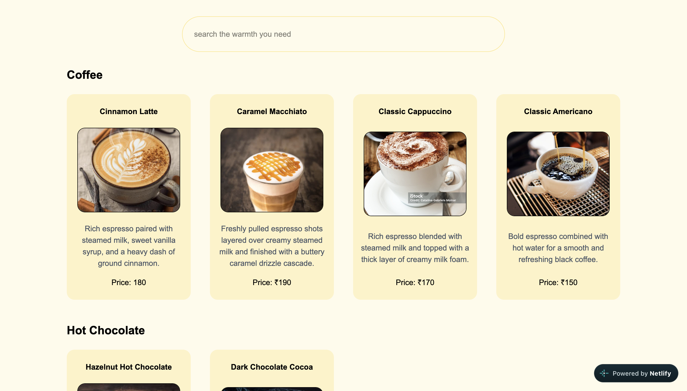

# The Warm Table ☕

A simple, welcoming website concept for a café, built to give visitors a quick look at the place, explore the menu, and find the information they need before visiting.

**Live Website:** https://thewarmtable.netlify.app/

## About the Project

The Warm Table is a café website I built as a personal web development project. I wanted to create something that felt warm and easy to use, rather than just putting together a basic landing page.

The website includes a hero section, an interactive menu, information about the café, and a section where visitors can find its location and working hours.

## Screenshots

### Desktop View


### Menu



### Mobile View


## Features

- Responsive layout for desktop and mobile screens
- Navigation bar with a mobile menu
- Menu section with multiple food and drink options
- Search functionality to find menu items
- Menu items organised into categories
- About Us section
- Visit Us section with location and working hours
- Footer with useful links and social links

## Technologies Used

- HTML5 – Website structure
- Tailwind CSS – Styling and responsive design
- JavaScript – Menu search, category organisation, and mobile navigation
- Vite – Development server and production build
- Netlify – Deployment and hosting

## Running the Project Locally

If you want to explore the project on your own machine:

1. Clone the repository:

   ```bash
   git clone https://github.com/Skiller969/The-Warm-table-.git
   ```

2. Open the project folder:

   ```bash
   cd The-Warm-table-
   ```

3. Install dependencies:

   ```bash
   npm install
   ```

4. Start the development server:

   ```bash
   npm run dev
   ```

5. Open the local URL shown in your terminal.

## Building for Production

To create the production build:

```bash
npm run build
```

The generated files will be available in the `dist` folder.

## Deployment

The website is deployed using Netlify and connected to GitHub for deployment updates.

**Live link:** https://thewarmtable.netlify.app/

---

Built as a personal project while learning and practising frontend web development.

**GitHub:** [Skiller969](https://github.com/Skiller969)
